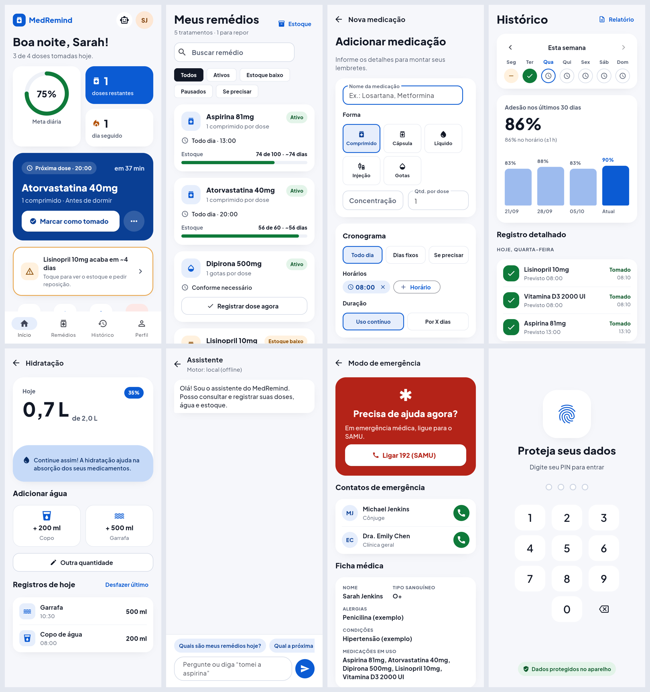
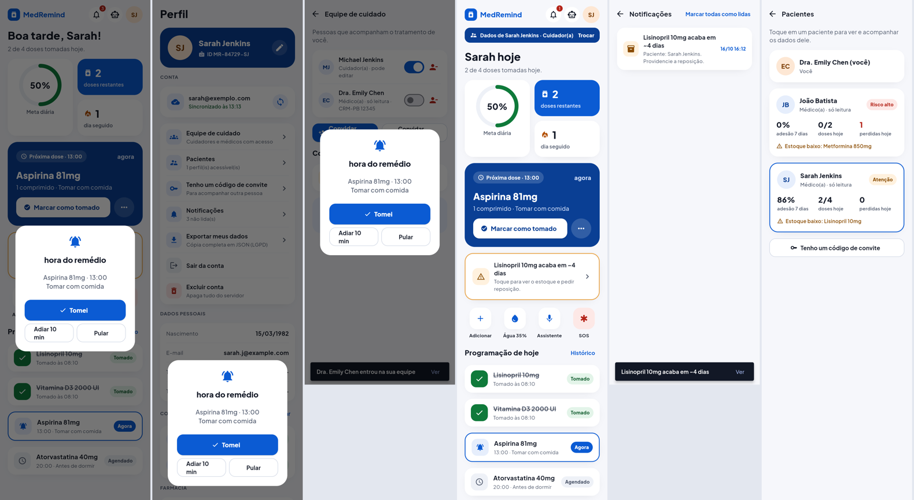

# MedRemind

Sistema de gestão de medicações com **app multiplataforma** (Python + Flet: Android, iOS, web e desktop) e
**backend** (FastAPI + PostgreSQL). Atende três perfis: **paciente**, **cuidador** e **profissional de saúde**.




- O app funciona **offline**. Com uma conta, ele sincroniza entre aparelhos e com a equipe de cuidado.
- Os dados de saúde seguem a LGPD (art. 11): consentimento no cadastro, acesso só com permissão do paciente,
  auditoria, portabilidade (exportar) e eliminação (excluir conta).

## Começando

```bash
pip install -r requirements.txt

# 1) Servidor (SQLite, desenvolvimento) — documentação em http://localhost:8000/docs
uvicorn backend.main:app_factory --factory --reload

# 2) App
python main.py --web            # navegador: http://localhost:8550
python main.py                  # janela desktop
python main.py --web --demo     # dados de exemplo, sem conta

# Testes (40): núcleo, backend, sincronização e cliente
python -m pytest
```

Produção local com PostgreSQL, API e worker de alertas:

```bash
cp .env.example .env            # defina JWT_SECRET e POSTGRES_PASSWORD
docker compose up --build
```

## Funcionalidades

### Paciente
- **Início:** meta do dia, próxima dose (tomar, adiar, pular), alerta de estoque, atalhos e programação do dia.
- **Remédios:** busca e filtros, cadastro completo (5 formas, vários horários, dias fixos, "se precisar",
  duração), pausar e excluir.
- **Lembretes:** no horário, com adiar 10 min, pular e alerta persistente.
- **Histórico:** semana navegável, adesão de 30 dias, barras por semana e registro detalhado editável.
- **Estoque:** previsão de quando acaba, reposição e farmácia.
- **Hidratação:** meta configurável e registros do dia.
- **Assistente:** agente com ferramentas, offline ou com IA (Claude).
- **SOS:** ligar 192, contatos e ficha médica.
- **Relatório para o médico:** CSV e página para imprimir.
- **Segurança e dados:** PIN com bloqueio progressivo, backup com verificação SHA-256 e auditoria local.

### Conta e equipe de cuidado (novo)
- **Conta:** cadastro e login por e-mail; a sessão se renova sozinha e funciona em vários aparelhos.
- **Convites:** o paciente gera um código de 8 caracteres (válido por 7 dias, uso único) para um cuidador ou
  profissional, escolhendo entre **só leitura** e **pode editar**. Pode mudar ou remover o acesso a qualquer
  momento.
- **Troca de paciente:** quem acompanha outras pessoas vê uma faixa "Dados de Fulano" e troca com um toque.
  Cuidadores e profissionais abrem o app direto na lista de pacientes.
- **Painel de pacientes:** adesão de 7 dias, doses de hoje, doses perdidas, estoque baixo e um nível de risco
  (alto, atenção ou em dia), com os mais urgentes no topo.
- **Notificações:** a caixa de entrada mostra quando uma dose passa do horário sem registro (para cuidadores
  e profissionais), quando um remédio está acabando e quando um convite é aceito. Tem contador no sino e push
  pelo Firebase, se configurado.
- **LGPD:** exportar todos os meus dados em JSON e excluir a conta com tudo o que está no servidor.
- **Sincronização:** status, alterações pendentes e botão "Sincronizar agora".

## Arquitetura

```
medremind/                    app + núcleo compartilhado
├── core/                     regras de negócio (sem interface, sem HTTP)
│   ├── models.py             dataclasses de domínio
│   ├── db.py                 SQLite local com migrações (v2: uuid, updated_at, deleted, dirty)
│   ├── repositories.py       SQL local; toda escrita marca "sujo" para sincronizar
│   ├── sync.py               protocolo de sincronização + motor do cliente
│   └── services/             agenda, adesão, estoque, lembretes, assistente, relatórios, PIN, backup
├── client/                   conversa com o servidor
│   ├── api.py                cliente HTTP com renovação automática de token
│   └── session.py            conta, pacientes acessíveis, um cache SQLite por paciente
└── ui/                       Flet: tema, componentes e uma função por tela

backend/                      servidor
├── orm.py                    modelo relacional (SQLAlchemy 2)
├── adapters.py               os MESMOS serviços do núcleo rodando sobre o PostgreSQL
├── sync_service.py           lado servidor da sincronização
├── security.py               scrypt, JWT, refresh token com rotação e detecção de reuso
├── deps.py                   autenticação e controle de acesso por paciente
├── notifications.py          caixa de entrada, push (FCM) e varredura de alertas
├── routers/                  auth · me · patients · care
├── migrations/               Alembic
├── main.py                   app FastAPI, middlewares, agendador
└── worker.py                 varredura de alertas fora da API (cron/compose)
```

### Decisões principais

**A regra de negócio é escrita uma vez só.** Os serviços de `medremind/core` dependem apenas da *interface*
dos repositórios. O app usa repositórios SQLite e o servidor usa adaptadores SQLAlchemy (`backend/adapters.py`).
Assim, agenda, adesão, estoque, relatórios e assistente dão o mesmo resultado nos dois lados.

**Offline-first com cache por paciente.** As telas sempre leem e gravam no SQLite local, por isso são
instantâneas e funcionam sem internet. O `SyncEngine` faz uma ida e volta em `POST /patients/{id}/sync`:
- **sobe** o que está marcado como sujo;
- **desce** o que mudou desde o último `cursor`.

Os conflitos se resolvem assim:
- cada registro tem `uuid` global e `updated_at` em UTC, e a escrita mais recente vence;
- a exclusão é lógica, para que também chegue aos outros aparelhos;
- a mesma dose registrada offline em dois aparelhos é unificada pela chave natural (medicação + horário).

**O cursor é seguro sob concorrência.** O servidor numera cada alteração com um `seq` por paciente, usando
`UPDATE … RETURNING`. A linha do paciente fica travada até o commit, então duas requisições nunca recebem o
mesmo número.

**Permissão é verificada no servidor, sempre.** Toda rota passa por `patient_access`:
- quem não tem vínculo recebe **404**, que não revela se o paciente existe;
- escrita sem permissão recebe **403**;
- na sincronização, alterações de quem tem só leitura são recusadas, e o cliente baixa tudo de novo para
  desfazer a mudança local;
- no servidor, o assistente com só leitura tem as ferramentas de gravação bloqueadas.

**Sessão.**
- O token de acesso (JWT) vale 15 min; o refresh token vale 30 dias e é trocado a cada uso.
- Se um refresh token já usado for reapresentado, toda a família é revogada (indício de roubo).
- Trocar a senha derruba as outras sessões.
- Login e cadastro têm limite de tentativas por IP.

**Infraestrutura.**
- Cabeçalhos de segurança: `nosniff`, `DENY`, `no-store` e HSTS em produção.
- `X-Request-ID` e log de cada requisição.
- `/health` e `/ready`, que testa o banco.
- Erros de validação voltam em português.

**Horários no fuso do paciente.** O servidor calcula as doses no fuso de cada paciente (o padrão é
`America/Sao_Paulo`), mesmo rodando em UTC.

## API

Documentação interativa em `/docs`. Principais rotas (prefixo `/api/v1`):

| Área | Rotas |
|---|---|
| Autenticação | `POST /auth/register`, `/auth/login`, `/auth/refresh`, `/auth/logout`, `/auth/logout-all`, `/auth/change-password`, `GET /auth/me` |
| Conta | `GET /me/patients`, `/me/dashboard`, `/me/notifications`, `POST /me/notifications/read-all`, `POST /me/devices`, `GET /me/export`, `DELETE /me` |
| Paciente | `GET /patients/{id}` (resumo), `GET/PUT /profile`, CRUD `/medications`, `/medications/{id}/refill`, `/pause` |
| Doses | `GET /doses?day=`, `/doses/next`, `POST /doses/action` (take, skip, snooze, undo — idempotente) |
| Acompanhamento | `/water`, `/contacts`, `/adherence?days=`, `/week`, `/stock`, `/reports/doses.csv`, `/reports/summary.html`, `POST /assistant`, `GET /audit` |
| Equipe | `GET /patients/{id}/care-team`, `POST /invites`, `DELETE /invites/{code}`, `PATCH/DELETE /care-team/{member}`, `POST /invites/accept` |
| Sincronização | `POST /patients/{id}/sync` |

## Configuração

| Variável | Onde | Uso |
|---|---|---|
| `DATABASE_URL` | servidor | `postgresql+psycopg://…` (produção) ou `sqlite:///…` (desenvolvimento) |
| `JWT_SECRET` | servidor | Obrigatório em produção |
| `MEDREMIND_ENV` | servidor | `production` liga HSTS e exige segredo |
| `CORS_ORIGINS` | servidor | Origens do app web, separadas por vírgula |
| `SCHEDULER_ENABLED` / `SCHEDULER_INTERVAL_SECONDS` | servidor | Varredura de alertas dentro da API |
| `FCM_SERVER_KEY` | servidor | Push no Android e no iOS |
| `ANTHROPIC_API_KEY` / `MEDREMIND_LLM_MODEL` | os dois | Assistente com IA |
| `MEDREMIND_SERVER_URL` | app | Endereço do servidor |
| `MEDREMIND_DATA_DIR` | app | Pasta dos dados locais |

Migrações: `alembic upgrade head`. Para mudar o modelo, rode `alembic revision --autogenerate -m "..."`.

## Testes

```bash
python -m pytest                                                     # tudo com SQLite
TEST_DATABASE_URL=postgresql+psycopg://user@host/db pytest tests/test_backend.py   # backend no PostgreSQL
```

O CI no GitHub Actions faz quatro coisas:
- lint e testes em Python 3.10, 3.12 e 3.13;
- testes do backend num PostgreSQL 16 real;
- `alembic check`, que garante que modelo e migração batem;
- build da imagem Docker.

## Limitações conhecidas e próximos passos

- **Notificação com o app fechado.** No celular, exige uma extensão Flet nativa
  (`flutter_local_notifications` / FCM). O servidor já registra aparelhos e envia push.
- **Biometria.** Exige uma extensão `local_auth`. Hoje o bloqueio é por PIN.
- **Estoque com edição simultânea.** Se dois aparelhos tomarem doses offline ao mesmo tempo, vale a última
  contagem enviada. O próximo passo é calcular o estoque a partir dos registros de dose.
- **Várias réplicas da API.** O limite de tentativas fica em memória; com mais de uma instância, troque por
  Redis.
- **App web para várias pessoas.** O modo `--web` é pensado para uso pessoal. Para hospedar para várias
  pessoas, crie uma sessão por página.

> O MedRemind organiza lembretes e registros. Ele não substitui orientação médica.

## Licença

Código sob a licença [MIT](LICENSE). A fonte Plus Jakarta Sans é distribuída sob a SIL Open Font License
(`assets/fonts/LICENSE_FONT`).
